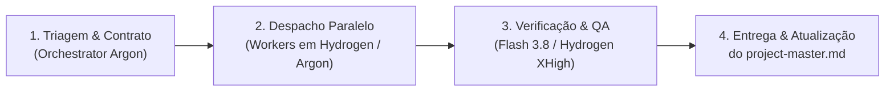

# Check-In Board — Workflow de Orquestração & Agentes (`agent-workflow.md`)

> Este documento define a arquitetura de trabalho em equipe para evoluir o **Check-In Board** usando **Orquestração Multi-Agente (Swarm / Subagentes)**.  
> O objetivo é que você peça uma entrega (do [Backlog Futuro (`docs/backlog.md`)](file:///c:/Users/Inbazz2/Documents/GitHub/check-in-board/docs/backlog.md) ou uma demanda nova) e o **Orquestrador** saiba exatamente **como quebrar a tarefa, para qual agente enviar e qual modelo de IA alocar** sem desperdiçar sua cota semanal do Argon.

---

## 1. Hierarquia Real dos Modelos: Qual IA Usar em Cada Tarefa

A escolha do modelo segue a regra de **força cognitiva vs. renovação de cota**:
- **Argon** (`Orchestrator` e `Gemini 4 Argon`) é o modelo **topo de linha (mais pesado)**, mas possui **cota semanal compartilhada**. Deve ser reservado para orquestração, arquitetura, problemas difíceis e lógica crítica.
- **Hydrogen** (`Gemini 4 Hydrogen`) é o **modelo ágil do dia a dia da geração Gemini 4**, com **cota que renova diariamente**. Deve puxar a maior parte da implementação de features, telas e CRUDs.
- **Flash 3.8** (`Gemini 3.8 Flash`) é o executor leve para tarefas mecânicas, lint/testes e automação de navegador (`browser`).

| Modelo | Perfil & Cota | Quando o Orquestrador Deve Escolher |
| :--- | :--- | :--- |
| **`Orchestrator (Argon)`** | Líder Técnico / Coordenador *(Cota Semanal Argon)* | **Para coordenar o Swarm.** Planeja a rodada, lê o [Arquivo Mestre (`docs/project-master.md`)](file:///c:/Users/Inbazz2/Documents/GitHub/check-in-board/docs/project-master.md), define contratos JSON/REST entre Spring e Web, despacha os agentes certos e faz o aceite final. |
| **`Gemini 4 Argon (Medium / High)`** | Especialista Pesado / Topo de Linha *(Cota Semanal Argon)* | **Apenas para problemas complexos, arquitetura crítica e bugs difíceis.** Ex: motor de sincronização/merge de múltiplos feeds iCal, fusos horários e *overbooking*, cálculos financeiros complexos de repasse/comissão, segurança/RBAC multi-tenant e refatorações estruturais. |
| **`Gemini 4 Hydrogen (Medium / High / XHigh)`** | Engenheiro do Dia a Dia *(Cota Diária — Renova Todo Dia)* | **O cavalo de batalha para ~80% das tarefas do projeto.** Criar e atualizar telas em `apps/web`, implementar endpoints REST/CRUD e DTOs em `apps/backend-spring`, construir modais seguindo o `docs/DESIGN.md`, filtros, formulários e testes de integração. Use `Medium/High` por padrão e `XHigh` quando a feature do dia a dia exigir mais atenção. |
| **`Gemini 3.8 Flash (Low / Medium / High)`** | Executor Ultrarrápido & Browser *(Cota Diária)* | **Para tarefas mecânicas, repetitivas e validação visual.** Rodar e corrigir `typecheck`/`lint`, mover strings para `apps/web/src/i18n/pt-br.ts`, criar seeds/mocks e operar o subagente `browser` para testar o layout em `375px` (mobile) e `1280px` (desktop). |

---

## 2. Papéis dos Agentes e Fronteiras de Arquivos (Zero Conflito)

Regra número 1 do Swarm: **dois agentes nunca editam o mesmo arquivo ao mesmo tempo.** O monorepo é dividido em territórios exclusivos:

### 2.1 Coordenador (`coordinator` — `Orchestrator (Argon)`)
- **Dono de:** `docs/*`, `package.json` (raiz) e definição dos contratos de API entre Backend e Frontend.
- **Regra:** **Não gasta turnos escrevendo código de feature.** Lê o pedido do usuário, consulta `docs/project-master.md` e `docs/backlog.md`, define o contrato de dados, aciona os workers (priorizando `Hydrogen` e `Flash` para economizar a cota do `Argon`) e valida a entrega.

### 2.2 Agente Backend (`backend` — `Hydrogen` no dia a dia | `Argon` em lógica crítica)
- **Dono exclusivo de:** `apps/backend-spring/**` (Controllers, Services, Repositories, Entities, DTOs, Security, Parser iCal e migrações Flyway `src/main/resources/db/migration/V*__.sql`).
- **Seleção de Modelo pelo Orquestrador:**
  - **`Gemini 4 Hydrogen (High / XHigh)` (Padrão do dia a dia):** novos endpoints REST, DTOs, CRUDs de domínio, filtros e testes `MockMvc`.
  - **`Gemini 4 Argon (High)` (Escalada pesada):** algoritmos de reconciliação iCal, concorrência/locks, regras financeiras delicadas ou mudanças na camada de segurança/JWT/RBAC.
- **Check obrigatório antes de concluir:** `pnpm test:backend-spring` e `pnpm build:backend-spring`.

### 2.3 Agente Web & Design System (`web` — `Hydrogen` no dia a dia | `Argon` em UI complexa)
- **Dono exclusivo de:** `apps/web/**`, `apps/finance-mvp/**` e `packages/design-system/**`.
- **Seleção de Modelo pelo Orquestrador:**
  - **`Gemini 4 Hydrogen (High)` (Padrão do dia a dia):** páginas de listagem, formulários, integração com APIs do Spring, tabelas, cards responsivos e ajustes de componentes.
  - **`Gemini 4 Argon (Medium / High)` (Escalada pesada):** criação de componentes interativos complexos do zero (como o Cronograma/Tape Chart ou modais multi-etapa com estado complexo).
- **Regras obrigatórias:** Seguir estritamente o [DESIGN.md](file:///c:/Users/Inbazz2/Documents/GitHub/check-in-board/docs/DESIGN.md) (*Carbon Enterprise*): zero overflow (`min-w-0`), modais tripartidos, badges atômicas (`whitespace-nowrap`), cards no mobile (`md:hidden`) + tabelas no desktop (`hidden md:block`).
- **Check obrigatório antes de concluir:** `pnpm --filter @check-in-board/web typecheck` e `pnpm build:web`.

### 2.4 Agente Mobile (`mobile` — `Gemini 4 Hydrogen (High)`)
- **Dono exclusivo de:** `apps/mobile/**`.
- **Quando acionar:** Quando uma tarefa pedir evolução no aplicativo Expo/React Native.
- **Check obrigatório antes de concluir:** `pnpm --filter @check-in-board/mobile typecheck`.

### 2.5 Agente Verificador / QA & Browser (`verifier` / `qa` — `Gemini 3.8 Flash` ou `Hydrogen XHigh`)
- **Papel:** Auditar o trabalho dos agentes autores antes de dar a rodada como pronta.
- **Seleção de Modelo pelo Orquestrador:**
  - **`Gemini 3.8 Flash (High)`:** rodar builds/testes, padronizar textos em `apps/web/src/i18n/pt-br.ts` e inspecionar visualmente as telas no navegador (`375px` mobile e `1280px` desktop).
  - **`Gemini 4 Hydrogen (XHigh)`:** revisão de código (*Code Review*) verificando se o contrato foi cumprido e se não há brechas de permissão entre organizações/apartamentos.

---

## 3. Protocolo de Execução do Orquestrador (Passo a Passo)

Sempre que você pedir uma tarefa ou rodada de melhorias, o Orquestrador segue este fluxo em **4 etapas**:

### Etapa 1: Triagem e Definição do Contrato
1. O Orquestrador lê a tarefa e identifica quais camadas são afetadas (`backend-spring`, `web`, `finance-mvp`, `mobile`).
2. Se a tarefa envolver Backend e Web ao mesmo tempo, o Orquestrador **define o contrato exato (rota HTTP, payload de request e JSON de response) no próprio brief** antes de disparar os agentes. Assim, `backend` e `web` trabalham **em paralelo** sem bloqueio.

### Etapa 2: Despacho com o Modelo Ideal (`swarm` ou `invoke_subagent`)
O Orquestrador cria cada worker especificando claramente:
- **O que ele é dono** (lista exata de pastas/arquivos que pode editar);
- **O que ele NÃO pode tocar** (para evitar colisão no git);
- **O contrato de dados e as regras de UI/negócio** (`docs/DESIGN.md` e `docs/project-master.md`);
- **O modelo cravado (`model`)** priorizando **Hydrogen** para o trabalho diário e reservando **Argon** para nós críticos;
- **O comando de validação** que deve passar antes de postar a conclusão.

#### Exemplo Real de Despacho pelo Orquestrador:
> **Cenário:** Implementar *"Taxa de Administração por Proprietário nos Repasses (`FUT-FIN-02`)"*
> - **Worker 1 (`backend-finance`):** Modelo `gemini-4-argon-high` (regra financeira crítica em centavos + migration Flyway + testes de precisão). Escopo: `apps/backend-spring/src/main/java/com/checkinboard/backend/modules/owners/**`, `modules/finance/**` e `db/migration/V14__*.sql`.
> - **Worker 2 (`web-finance`):** Modelo `gemini-4-hydrogen-high` (trabalho de UI do dia a dia: adicionar campo de comissão no form de proprietário e exibir no modal de faturamento/relatório A4 seguindo `DESIGN.md`). Escopo: `apps/web/src/features/owners/**`, `features/finance/**` e `features/calendar/components/calendar-reports-modal.tsx`.
> - **Worker 3 (`verifier-qa`):** Modelo `gemini-3.8-flash-high` (valida `pnpm test:backend-spring`, `pnpm build:web` e checa responsividade mobile/desktop).

### Etapa 3: Revisão Rigorosa (Checklist de Aceite)
O Orquestrador só aceita a entrega dos agentes quando:
- [ ] Todos os testes do Spring (`pnpm test:backend-spring`) passaram;
- [ ] O `typecheck` e o `build` do Web (`pnpm build:web`) passaram sem erros;
- [ ] Nenhuma regra de layout do `docs/DESIGN.md` foi violada (sem overflow em 375px, sem badges quebrando linha, sem hexadecimais fora do tema);
- [ ] Todos os endpoints novos validam permissão por organização/apartamento.

### Etapa 4: Atualização da Documentação Viva e Commit Local
- Quando uma feature do `docs/backlog.md` é concluída, ela é **removida do `docs/backlog.md`** e passa a constar na seção *"O Que Já Está Implementado"* do **`docs/project-master.md`**.
- **Regra de Git:** Sempre que finalizar e validar o código (`typecheck` / `test` passando), fazer o **`git commit` local** com mensagem clara por contexto. **Não fazer `git push`** (o usuário faz o push manualmente).
